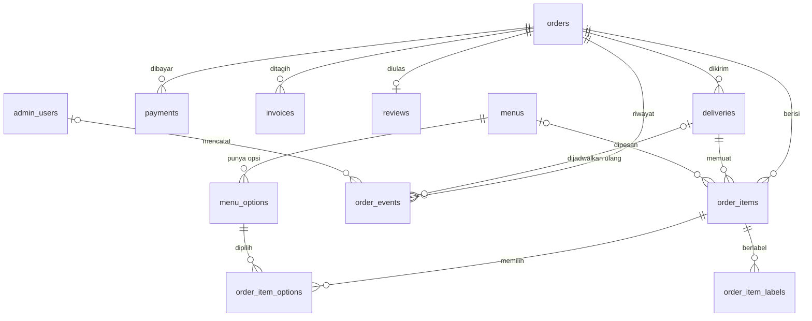

# ERD macymoo

Sumber awal: `erd_macyourmoo.drawio` dari tim DS, direvisi sesuai catatan review DS dan KF.
Nilai teks dan kolom disamakan dengan `docs/openapi.yaml` (kontrak API).
Kolom dan tipe lengkap ada di `backend/migrations/001_init.sql`.

Tabel mandiri (tanpa relasi): `closed_dates`, `settings`, `chat_logs`, `rate_limits`.

## Aturan perhitungan

- Uang adalah bilangan bulat Rupiah.
- `order_items.unit_price` adalah harga dasar yang disalin saat pesan.
- `order_item_options.extra_price` adalah harga tambahan opsi yang disalin saat pesan.
- Total item = `qty × (unit_price + jumlah extra_price opsi item itu)`.
- Ongkir hanya di `deliveries.shipping_fee`. Tidak ada kolom total di `orders` maupun `invoices`.
- Pembayaran bersih = (`dp` + `pelunasan`) − `refund`.
- `invoices.invoice_no` disimpan tanpa akhiran `-v2`; revisi ada di kolom `revision`.

## Nilai yang dibakukan (CHECK di database)

| Kolom | Nilai |
|---|---|
| `orders.status` | menunggu_konfirmasi (default), menunggu_pembayaran, diproses, selesai, dibatalkan |
| `orders.source` | web_form, admin_form |
| `orders.pay_timing` | di_muka (default), setelah_kirim |
| `orders.pay_status` | belum_bayar (default), dp, lunas, dikembalikan |
| `deliveries.method` | antar_nabila, ambil_sendiri |
| `deliveries.delivery_status` | dijadwalkan (default), terkirim |
| `order_items.item_type` | menu, item_bebas, bundling, bonus, kolaborasi |
| `payments.type` | dp, pelunasan, refund |
| `payments.method` | qris, transfer, tunai |
| `reviews.moderation_status` | pending, approved, rejected |
| `order_events.event_type` | order_created, confirmed, bill_sent, rescheduled, delivery_delivered, payment_recorded, cancelled, completed |
| `order_events.from_status`, `to_status` | Sama dengan lima status pesanan |

Nilai di atas berupa kode; teks tampilan (mis. "Menunggu Konfirmasi") dipetakan di frontend.

`menu_options.option_group` divalidasi di backend (Joi), bukan di database.

Satu pembatalan = satu event `cancelled`. "Lewat batas bayar" tidak punya event: dihitung saat dibaca dari `orders.invoice_sent_at`.

`menus.description` (teks, boleh kosong) ada di skema karena skema `Menu` di kontrak API memuatnya.

Catatan untuk backend: `order_item_options.extra_price` tidak punya default, jadi harga opsi wajib disalin saat pesan dibuat (isi 0 bila gratis). Item bertipe `menu` wajib punya `menu_id`.

`rate_limits` tidak ada di ERD DS; ditambahkan karena KF bagian 11 menyimpan rate limit di database (serverless). Isinya hash alamat IP, bukan IP mentah.
