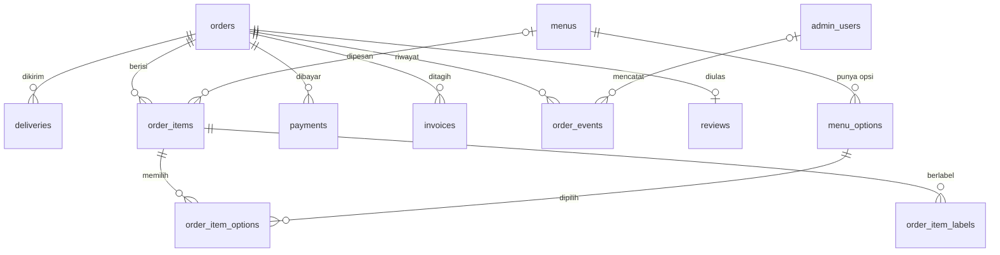

# ERD macymoo

Sumber: `erd_macyourmoo.drawio` dari tim DS, disepakati FS dan DS.
Kolom dan tipe lengkap ada di `backend/migrations/001_init.sql`.

Tabel mandiri (tanpa relasi): `closed_dates`, `settings`, `chat_logs`.
